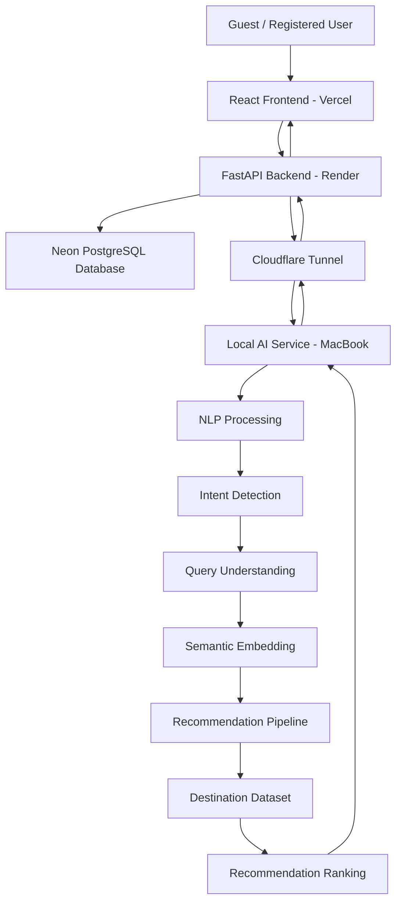

# Ghumantey – AI-Powered Travel Recommendation System

An intelligent travel recommendation platform that helps users discover destinations in Nepal through natural-language queries, personalized recommendations, destination information, and travel-related services.

**Project Type:** Minor Year Project  
**Application:** Web-Based AI Travel Recommendation System  
**Primary Focus:** Nepal Tourism  
**Frontend:** React + Vite  
**Backend:** FastAPI  
**Database:** PostgreSQL (Neon)  
**AI/ML:** NLP, Semantic Embeddings, Intent Detection, Content-Based Recommendation

---

# 1. Project Overview

Ghumantey is an AI-powered travel recommendation system designed to make travel planning easier by helping users discover destinations that match their interests, preferences, travel requirements, and budget.

Instead of requiring users to search through destinations using fixed filters, Ghumantey allows them to enter natural-language queries such as:

- "Suggest peaceful places in Nepal for a family trip."
- "I want to visit beautiful places near Pokhara."
- "Recommend adventurous destinations within NPR 10,000."
- "Find destinations suitable for nature lovers."

The system processes the user's query using Natural Language Processing (NLP), identifies the user's intent, understands relevant preferences, and generates appropriate travel recommendations.

Ghumantey also provides destination information, destination search, activity-related search, and accommodation-related functionality.

The platform supports both registered users and guest users for travel recommendations.

## 1.1 Main Features

- Natural-language travel queries.
- AI-powered destination recommendations.
- Intent detection and query understanding.
- Semantic similarity-based recommendation.
- Content-based destination recommendation.
- Destination information and search.
- Activity-related search.
- Accommodation-related functionality.
- User registration and authentication.
- Guest and registered-user access.
- PostgreSQL-based destination and user data management.
- Travel recommendations focused on destinations in Nepal.

---

# 2. System Architecture

Ghumantey follows a frontend-backend architecture with a separate AI inference service.

The frontend communicates with the FastAPI backend. The backend handles authentication, database operations, API requests, and communication with the AI service.

The AI recommendation pipeline currently runs on a local MacBook and is exposed to the deployed backend through Cloudflare Tunnel.

## 2.1 Architecture Diagram



## 2.2 Component Responsibilities

| Component | Responsibility |
|---|---|
| React Frontend | User interface and interaction |
| FastAPI Backend | API handling, authentication, and business logic |
| Neon PostgreSQL | Persistent application data |
| AI Service | AI inference and recommendation processing |
| NLP Pipeline | Query processing and intent understanding |
| Embedding Model | Semantic representation of queries and destinations |
| Recommendation Engine | Destination matching and ranking |
| Cloudflare Tunnel | Secure communication between Render and the local AI service |

---

# 3. Technology Stack

## 3.1 Frontend

- React 18
- Vite
- JavaScript
- Axios
- React Router
- Tailwind CSS
- Framer Motion
- React Icons
- Recharts

The frontend provides the user interface, destination browsing, registration, login, and interaction with backend APIs.

## 3.2 Backend

- Python 3.11
- FastAPI
- Uvicorn
- SQLAlchemy
- PostgreSQL
- Pydantic
- Passlib
- Bcrypt 4.0.1
- Requests

The backend provides REST APIs, manages user authentication, communicates with PostgreSQL, and forwards AI recommendation requests to the AI service.

## 3.3 AI and Machine Learning

The project integrates several AI/ML components:

- Natural Language Processing.
- Intent detection.
- Semantic query understanding.
- Sentence embeddings.
- Content-based recommendation.
- Query-based destination recommendation.
- Similar-destination recommendation.
- Recommendation ranking.

The sentence-transformer model used in the semantic embedding pipeline is:

**`all-MiniLM-L6-v2`**

The semantic model is shared through a model loader to avoid unnecessary repeated model loading.

The language-model integration in the NLP pipeline uses:

- Ollama API integration.
- `qwen2.5:3b` as the configured model.
- Regex and semantic-based fallback processing.

**Deployment note:** The Ollama integration is not currently confirmed as available in the deployed environment. The recommendation service should be tested using its fallback behavior as well.

## 3.4 Database

Ghumantey uses PostgreSQL for persistent storage.

The production database is hosted on Neon.

Main database tables include:

- users
- destinations
- categories
- activities
- destination_category
- destination_activity
- destination_embeddings
- images
- homestays
- bookings
- reviews
- favorites
- search_history
- sentiment_analysis

The database contains migrated project data, including destination records, homestays, user accounts, and booking records.

---

# 4. AI Recommendation Workflow

The AI recommendation system is the central intelligent component of Ghumantey.

## 4.1 User Query

The user submits a natural-language travel query through the frontend.

Example:

"Suggest peaceful destinations in Nepal for a family trip."

## 4.2 NLP Processing

The query is passed to the NLP pipeline, which processes the natural-language input.

The pipeline identifies relevant information and prepares the query for recommendation.

## 4.3 Intent Detection

The system determines what the user wants to do.

The AI pipeline supports the following intent categories:

- Recommendation
- Similar destination
- Destination information
- Destination search
- Activity search
- Accommodation search
- Greeting

## 4.4 Semantic Processing

The system uses Sentence Transformers to generate semantic embeddings.

The configured embedding model is `all-MiniLM-L6-v2`.

These embeddings help represent the meaning of the user's query and destination-related information.

## 4.5 Destination Recommendation

The recommendation pipeline uses query-based and content-based recommendation methods.

It processes the user's preferences and identifies destinations that are relevant to the query.

## 4.6 Ranking

The recommendation results are ranked to prioritize destinations that best match the user's requirements.

## 4.7 Response Generation

The AI service returns the processed results to the backend.

The backend sends the response to the React frontend, where the recommended destinations are displayed.

---

# 5. Project Directory Structure

The main project structure is organized as follows:

```text
MinorProject_TripAi/
│
├── src/
│   ├── api/
│   │   └── client.js
│   ├── components/
│   ├── pages/
│   └── ...
│
├── public/
│
├── backend/
│   ├── app/
│   │   ├── api/
│   │   │   ├── auth.py
│   │   │   ├── ai.py
│   │   │   └── ...
│   │   │
│   │   ├── core/
│   │   │   └── database.py
│   │   │
│   │   ├── models/
│   │   ├── schemas/
│   │   ├── services/
│   │   └── ...
│   │
│   ├── ml/
│   │   ├── ai_pipeline.py
│   │   └── embeddings/
│   │
│   ├── ai_service.py
│   ├── requirements.txt
│   └── ...
│
├── nlp/
│   ├── layers/
│   └── model_loader.py
│
├── sentiment_analysis/
│
├── package.json
├── package-lock.json
├── vercel.json
├── .vercelignore
├── index.html
└── README.md
```

**Note:** This is a high-level representation of the project structure. Some folders contain additional modules and files.

---

# 6. Deployment Architecture

Ghumantey uses a hybrid deployment architecture.

Different parts of the application are deployed separately according to their responsibilities.

| Application Component | Hosting Platform | Deployment |
|---|---|---|
| React Frontend | Vercel | Cloud |
| FastAPI Backend | Render | Cloud |
| PostgreSQL Database | Neon | Cloud |
| AI Recommendation Service | Local MacBook | Local |
| AI Service Public Access | Cloudflare Tunnel | Tunnel |
| Sentiment Analysis | Not deployed | Excluded for now |

## 6.1 Frontend – Vercel

**Live URL:**  
https://trip-ai-nu.vercel.app

The React application is deployed through Vercel using the GitHub repository.

Configuration:

- Framework: Vite
- Root Directory: `./`
- Install Command: `npm install`
- Build Command: `npm run build`
- Output Directory: `dist`

The frontend uses an environment variable to communicate with the production backend.

```env
VITE_API_BASE_URL=https://ghumantey-backend.onrender.com
```

The API client reads this variable through:

```javascript
import.meta.env.VITE_API_BASE_URL
```

## 6.2 Backend – Render

**Live URL:**  
https://ghumantey-backend.onrender.com

**API Documentation:**  
https://ghumantey-backend.onrender.com/docs

The FastAPI application is deployed on Render.

Configuration:

- Root Directory: `backend`
- Build Command:

```bash
pip install -r requirements.txt
```

- Start Command:

```bash
uvicorn app.main:app --host 0.0.0.0 --port $PORT
```

Required environment variables:

```env
DATABASE_URL=your_neon_database_connection_string
SECRET_KEY=your_application_secret
AI_SERVICE_URL=your_current_cloudflare_tunnel_url
AI_SERVICE_TOKEN=your_ai_service_token
```

These values must be configured in Render's Environment settings, not committed to GitHub.

**Important:** Render's free service may sleep when inactive. The first request after inactivity may take longer because the service needs to start.

## 6.3 Database – Neon

The production PostgreSQL database is hosted on Neon.

The backend connects to Neon using the `DATABASE_URL` environment variable.

The database was migrated from the original local PostgreSQL database.

The migrated data includes destination records, homestays, users, bookings, and associated relational data.

The original local database and backup files have been preserved.

## 6.4 AI Service – Local MacBook

The AI recommendation service runs separately from the deployed backend.

Its main file is:

```text
backend/ai_service.py
```

The service uses:

- FastAPI
- AIPipeline
- NLP processing
- Sentence Transformers
- Destination recommendation logic

It runs locally on:

```text
http://127.0.0.1:8001
```

The Render backend cannot directly access the MacBook's localhost. Therefore, Cloudflare Tunnel exposes the local AI service through a temporary public HTTPS address.

The backend forwards recommendation requests to the tunnel.

**Important operational limitation:** The AI recommendation feature depends on the MacBook remaining switched on, connected to the internet, and running both the AI service and Cloudflare Tunnel.

The Cloudflare Quick Tunnel URL may change after restarting the tunnel. If it changes, update `AI_SERVICE_URL` in Render.

## 6.5 Sentiment Analysis

The project also contains a separate sentiment-analysis module.

It is currently excluded from production deployment because it is not part of the operational deployment setup.

Its source code and local data are retained.

---

# 7. Environment Configuration

The application uses environment variables to configure communication between its components.

| Variable | Location | Purpose |
|---|---|---|
| `VITE_API_BASE_URL` | Vercel | Production backend URL |
| `DATABASE_URL` | Render | Neon PostgreSQL connection |
| `SECRET_KEY` | Render | Authentication security |
| `AI_SERVICE_URL` | Render | Public AI service tunnel URL |
| `AI_SERVICE_TOKEN` | Render and local AI service | Authenticated AI service communication |

Never upload `.env` files, passwords, database connection strings, or service tokens to GitHub.

The production frontend environment variable is:

```env
VITE_API_BASE_URL=https://ghumantey-backend.onrender.com
```

---

# 8. Running Ghumantey Locally

The following instructions describe how to start the project during local development.

## 8.1 Prerequisites

Install or configure:

- Python 3.11
- Node.js and npm
- Conda
- PostgreSQL or access to the Neon database
- Cloudflared, if using the tunnel
- Git

## 8.2 Start the Backend

Open Terminal 1.

```bash
cd ~/Desktop/MinorProject_TripAi/backend
conda activate ds
source ../.venv/bin/activate
uvicorn app.main:app --reload
```

The local backend runs at:

```text
http://localhost:8000
```

API documentation:

```text
http://localhost:8000/docs
```

## 8.3 Start the Frontend

Open Terminal 2.

```bash
cd ~/Desktop/MinorProject_TripAi
npm install
npm run dev
```

The frontend runs at:

```text
http://localhost:5173
```

The local frontend should use the local backend URL unless `VITE_API_BASE_URL` is configured for another environment.

---

# 9. Operating the Deployed Ghumantey Application

This section is especially important for demonstrations and day-to-day operation.

The frontend, backend, and database are already hosted online. The AI service, however, must be started manually on the MacBook.

## 9.1 Step 1 – Check the Internet Connection

Make sure the MacBook is:

- Switched on.
- Connected to the internet.
- Not in sleep mode during the demonstration.
- Connected to a stable network.

## 9.2 Step 2 – Start the AI Recommendation Service

Open Terminal 1.

```bash
cd ~/Desktop/MinorProject_TripAi/backend
conda activate ds
```

Load the existing AI service token:

```bash
export AI_SERVICE_TOKEN="$(cat /tmp/ghumantey_ai_token)"
```

Start the service:

```bash
uvicorn ai_service:app --host 127.0.0.1 --port 8001
```

Keep this terminal running.

The AI service should now be available locally at:

```text
http://127.0.0.1:8001
```

Check its health using another terminal:

```bash
curl http://127.0.0.1:8001/
```

Expected response:

```json
{
  "status": "AI service is running"
}
```

## 9.3 Step 3 – Start Cloudflare Tunnel

Open Terminal 2.

```bash
cloudflared tunnel --url http://127.0.0.1:8001
```

Cloudflare will generate a public HTTPS URL similar to:

```text
https://example-name.trycloudflare.com
```

Copy the exact generated URL.

Do not include `/ai/query` at the end.

## 9.4 Step 4 – Update Render if the Tunnel URL Changes

If the new Cloudflare URL differs from the existing one:

1. Open Render Dashboard.
2. Select `ghumantey-backend`.
3. Open Environment.
4. Find `AI_SERVICE_URL`.
5. Replace its value with the new Cloudflare HTTPS URL.
6. Save the changes.
7. Wait for the backend to become Live again.

Keep `AI_SERVICE_TOKEN` unchanged unless the local service token itself has changed.

If the URL has not changed, no update is needed.

## 9.5 Step 5 – Open Ghumantey

Open:

https://trip-ai-nu.vercel.app

The website should load from Vercel.

The backend communicates with Neon, while AI recommendation requests travel through Render and Cloudflare Tunnel to the local MacBook AI service.

## 9.6 Step 6 – Test the Application

Perform the following checks:

1. Open the homepage.
2. Open the destinations page.
3. Register a new test account if necessary.
4. Log in.
5. Submit a natural-language travel query.
6. Verify that recommendations are returned.
7. Open destination information.
8. Test other available travel-related features.
9. Check browser and Render logs if any request fails.

---

# 10. Troubleshooting Guide

| Problem | Possible Cause | Action |
|---|---|---|
| Website does not load | Frontend deployment issue | Check Vercel deployment status |
| API request fails | Backend unavailable | Check Render logs and service status |
| First API request is slow | Render free instance sleeping | Wait for the service to wake up |
| Registration fails | Backend or database issue | Inspect `/auth/register` response and Render logs |
| Login fails | Authentication or password issue | Check backend authentication logs |
| AI recommendations unavailable | Local AI service stopped | Restart `ai_service.py` |
| AI requests return 502 | Tunnel URL or connectivity issue | Check Cloudflare Tunnel and Render environment |
| AI requests return 401 | Token mismatch | Check that local and Render tokens match |
| AI requests time out | Slow inference or unavailable MacBook | Check the local service and model loading |
| Destination images return 404 | Static image hosting configuration | Check FastAPI static-file mounting and deployed image files |
| CORS errors | Frontend domain not allowed | Verify backend CORS configuration |

## 10.1 Current Known Destination Image Issue

The destinations API returns different image paths for different destinations.

For example:

```text
Phewa Lake:
  /destination-images/img1.jpg

Sarangkot:
  /destination-images/img2.jpg
```

However, opening these image URLs on the deployed backend currently returns:

```json
{
  "detail": "Not Found"
}
```

This indicates that production image serving is not yet working correctly.

The issue remains under investigation.

The existing image files and database records should be preserved while fixing the static-file hosting configuration.

---

# 11. Security and Maintenance

Important operational practices:

- Keep secrets outside the Git repository.
- Never commit `.env` files.
- Never expose `AI_SERVICE_TOKEN`.
- Keep the Neon database connection string private.
- Use HTTPS for production communication.
- Preserve database backups before database-level changes.
- Test backend changes locally before deployment.
- Deploy only the files required for a particular change.
- Monitor Render logs for backend errors.
- Keep the MacBook and AI service available during demonstrations.

The bcrypt dependency is pinned to:

```text
passlib==1.7.4
bcrypt==4.0.1
```

This combination was tested locally to resolve the production password-hashing compatibility error.

---

# 12. Deployment and Update Workflow

The project is connected to GitHub, allowing changes pushed to the main branch to trigger deployments.

## Frontend Updates

1. Modify the frontend source code.
2. Test locally.
3. Commit and push the required files.
4. Vercel automatically builds and deploys the frontend.

## Backend Updates

1. Modify the backend source code.
2. Test locally.
3. Commit and push the required files.
4. Render automatically builds and deploys the backend.

## AI Service Updates

1. Modify the AI service or recommendation pipeline.
2. Test the service locally.
3. Commit and push the required files if appropriate.
4. Restart the local AI service.
5. Keep Cloudflare Tunnel running.
6. Update `AI_SERVICE_URL` in Render if the tunnel URL changes.

## Database Updates

1. Back up the existing database.
2. Test the required schema or data changes.
3. Apply changes to Neon carefully.
4. Verify the affected tables and application functionality.

Never replace the production database with a local database without creating and verifying a backup.

---

# 13. Limitations

Current deployment limitations include:

1. The AI recommendation service runs on a local MacBook rather than a dedicated cloud server.
2. AI recommendations are unavailable when the MacBook or tunnel is offline.
3. Cloudflare Quick Tunnel URLs may change after restarting.
4. Render free services may sleep after inactivity.
5. Production destination image hosting is not yet fully configured.
6. The sentiment-analysis service is not included in the current production deployment.
7. Some advanced accommodation functionality may require further implementation and testing.

---

# 14. Future Enhancements

Potential future improvements include:

- Deploying the AI inference service to a dedicated cloud environment.
- Configuring a persistent Cloudflare Tunnel.
- Fixing and optimizing destination image hosting.
- Improving recommendation personalization.
- Integrating additional travel preferences.
- Enhancing activity and accommodation recommendations.
- Completing sentiment-analysis integration.
- Adding improved recommendation evaluation metrics.
- Improving scalability and response times.
- Adding more comprehensive monitoring and logging.

---

# 15. Important Production URLs

| Service | URL |
|---|---|
| Ghumantey Frontend | https://trip-ai-nu.vercel.app |
| Backend API | https://ghumantey-backend.onrender.com |
| Backend Swagger Documentation | https://ghumantey-backend.onrender.com/docs |
| Neon Database Console | https://console.neon.tech |
| Render Dashboard | https://dashboard.render.com |
| Vercel Dashboard | https://vercel.com/dashboard |

---

# 16. Final Project Summary

Ghumantey integrates frontend development, backend API engineering, PostgreSQL database management, Natural Language Processing, semantic embeddings, and intelligent recommendation techniques into a unified travel recommendation platform.

The system allows users to express travel requirements through natural language and receive relevant destination recommendations.

Its architecture separates the frontend, backend, database, and AI inference components, allowing each component to be maintained independently.

The frontend is deployed on Vercel, the backend on Render, the PostgreSQL database on Neon, and the AI recommendation service currently runs locally through Cloudflare Tunnel.

This hybrid architecture provides a working deployment without requiring paid cloud infrastructure for AI inference.

**Ghumantey – Discover Nepal, Intelligently.**